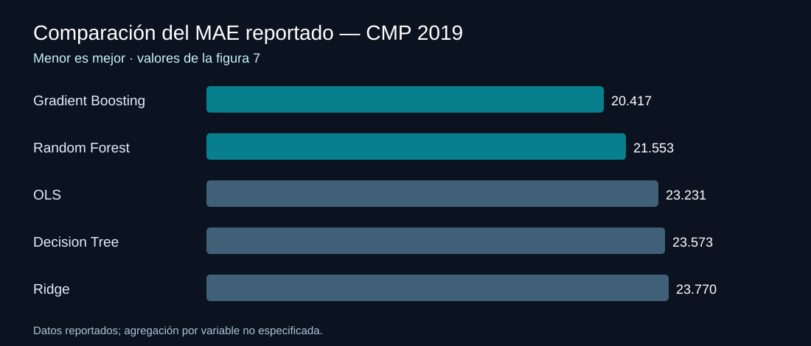

# Pronóstico de calidad de crudo pesado mediante Machine Learning

**Gerencia técnica · Inteligencia artificial industrial · Congreso Mexicano del Petróleo 2019**

Durante mi etapa como **Gerente Técnico de Plenumsoft Energy & Sustainability**, participé en un proyecto de investigación aplicada para **pronosticar parámetros de calidad del crudo pesado** durante los procesos de deshidratación y desalado en la **Terminal Marítima Dos Bocas**.

El trabajo reunió a especialistas de **PEMEX Exploración y Producción** y **Plenumsoft**, y participé como **coautor del artículo técnico presentado en el Congreso Mexicano del Petróleo 2019**.

Desarrollamos una **prueba de concepto** para explorar cómo los modelos de aprendizaje automático podían aprovechar datos históricos y apoyar decisiones relacionadas con el acondicionamiento del crudo.

## El desafío

La comercialización de crudo pesado exige atender parámetros de calidad como los **grados API, el contenido de agua y la concentración de sal**.

Nuestro objetivo fue investigar si podíamos **anticipar el comportamiento de esas variables** a partir de registros históricos de operación y comparar distintas técnicas predictivas para identificar las más prometedoras.

## La prueba de concepto

Trabajamos con **12 meses de información histórica** de dos líneas de proceso. Entre las variables estudiadas estaban los grados API, agua libre, emulsión y sal, además de información relacionada con volúmenes e inyección de crudo.

El trabajo comprendió preparación de datos, selección de variables, entrenamiento de modelos y comparación de pronósticos.

Evaluamos cinco enfoques:

| Modelo | Tipo |
| :--- | :--- |
| **Decision Tree** | Árbol de regresión |
| **Random Forest** | Ensamble de árboles |
| **Gradient Boosted Trees** | Ensamble secuencial de árboles |
| **Ordinary Least Squares (OLS)** | Regresión lineal |
| **Ridge Regression** | Regresión lineal regularizada |

La evaluación descrita en el trabajo utilizó una **partición 80 % / 20 %** entre entrenamiento y prueba, y el **error absoluto medio (MAE)** para comparar resultados.

## Resultados

En la comparación presentada en el congreso, **Gradient Boosted Trees** y **Random Forest** obtuvieron los menores valores de error entre los modelos analizados.

| Modelo | MAE presentado |
| :--- | ---: |
| **Gradient Boosted Trees** | **20.417** |
| **Random Forest** | **21.553** |
| Ordinary Least Squares | 23.231 |
| Decision Tree | 23.573 |
| Ridge Regression | 23.770 |

Los valores corresponden a la comparación global mostrada en la figura 7 del artículo técnico; no representan una única variable de calidad con unidades específicas.

También comparamos visualmente pronósticos y valores observados de **grados API, agua y sal**. La variable sal presentó diferencias más marcadas, un resultado relevante para identificar oportunidades de mejora del enfoque predictivo.

## Metodología

[Consultar la metodología y los resultados](docs/methodology-and-results.md).

## Mi participación

Participé desde la **Gerencia Técnica de Plenumsoft** y como **coautor** de la investigación.

El proyecto combinó conocimientos del proceso industrial, preparación y análisis de datos y técnicas de aprendizaje automático. Mi participación se desarrolló dentro de un equipo multidisciplinario de especialistas de PEMEX y Plenumsoft.

Esta experiencia forma parte de mi trayectoria en **dirección tecnológica, investigación industrial y aplicación de inteligencia artificial a problemas operativos**.

## Presentación en el Congreso Mexicano del Petróleo

El estudio se presentó en junio de **2019** con el título:

**«Simulador de los procesos de deshidratación y desalado del crudo pesado para cumplir con las especificaciones comprometidas en la fase de comercialización de hidrocarburos y derivados» (CMP2019_207).**

**Autor:** Bruno Pecero García — PEMEX Exploración y Producción.

**Coautores:** Felipe Pacheco Rosado, Minerva Rojas Solís, Yahvé Isaías Solís Aranda, Raúl López Altamirano y Gabriel Azuela Barajas — Plenumsoft Energy & Sustainability.

[Conocer mi participación y la autoría del proyecto](docs/scope-and-attribution.md).

## Sobre el proyecto

El desarrollo fue una **prueba de concepto de investigación**, no una implementación comercial del modelo predictivo. Este repositorio presenta el trabajo y los resultados de la investigación sin publicar los datos operativos ni el software propietario.

---

<strong>Aprendizaje automático aplicado a la ingeniería y a la toma de decisiones industriales.</strong>

<a href="https://github.com/isaiassolis">Volver a mi portafolio profesional</a>

